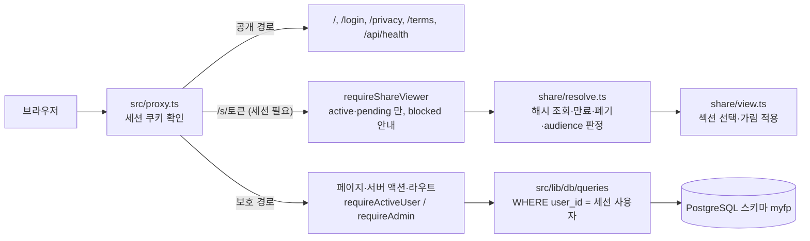

# myfp 구조

## 요청 흐름

## 디렉터리

| 경로 | 내용 |
|------|------|
| `src/app/(marketing)` | 공개 소개·약관 페이지 (디자인 단계는 이 폴더와 `src/components/marketing` 만 다룬다) |
| `src/app/app` | 로그인 후 화면 (`/app/*`) |
| `src/app/admin` | 관리자 화면 |
| `src/app/s/[token]` | 공유 보기 (읽기 전용, 로그인한 active·pending 사용자만) |
| `src/lib/auth-core` | 인증 관련 순수 로직 (경로 분류, callbackUrl 정리, 가입·연결 정책, 관문 판정) |
| `src/lib/finance` | 재무 순수 로직 (날짜·일정·검증·요약·CSV·시드 정규화) — 모두 Asia/Seoul 달력 날짜 |
| `src/lib/share` | 공유 토큰·설정·보기 데이터 |
| `src/lib/db` | 연결 풀과 쿼리 계층 (Db 인터페이스 주입 → 가짜 Db 로 시험) |
| `src/lib/actions` | 서버 액션 (`assertSameOrigin` → 세션 가드 → 검증 → 트랜잭션) |
| `src/lib/session.ts` | 신뢰 경계: 세션 → DB 사용자 → 상태·역할 판정 |
| `scripts` | 마이그레이션, 비밀번호 해시, 개인 데이터 적재, 공개 저장소 검사 |
| `tests` | `node --test` 시험 (DB 없음) |

## 데이터 모델

| 테이블 | 핵심 열 |
|--------|---------|
| `users` | email(신뢰 이메일만, 고유), name, image, status(pending·active·blocked), role(admin·member) |
| `accounts` | (provider, provider_account_id) → user_id |
| `fixed_expenses` | user_id, name, category, amount(bigint), cycle, billing_day(1–31, 31=말일), billing_month, payment_method, institution, start/end_date, active, note, source, archived_at, external_key |
| `balance_items` | user_id, kind(asset·liability), category, name, amount, as_of, note, monthly_payment, interest_rate, end_date, external_key |
| `balance_snapshots` | user_id, month(YYYY-MM), assets_total, liabilities_total — 자산·부채 변경 시 그 달 행 upsert (순자산 추이) |
| `share_links` | user_id, label, token_hash(SHA-256), scopes, masks, expires_at, revoked_at, view_count, last_viewed_at |
| `audit_log` | actor, action, target, before/after (추가 전용) |

## 차트

데이터 가공은 서버의 `src/lib/finance/charts.ts`·`projection.ts`(순수 함수)가 하고, `src/components/charts/*-chart.tsx`(use client)는 숫자만 받아 그린다.
공유 보기에서 금액을 숨기면 차트와 비중(%)을 아예 직렬화하지 않는다(비중만으로도 금액 하나를 알면 나머지를 역산할 수 있다). 그때는 이름·분류·납부일 같은 금액 아닌 세부 목록만 보낸다.
각 차트 옆(또는 「표로 보기」)에 같은 데이터를 목록·표로 둔다. 도넛 옆 세부 항목 목록의 정렬·필터는 `src/lib/finance/detail-list.ts`(순수 함수)가 URL 쿼리(sort·dir·cat)를 허용 목록으로 검증해 처리한다.

## 디자인 토큰

색·간격·반경·타이포는 `src/app/globals.css` 의 CSS 변수와 Tailwind 4 `@theme inline` 에 있다. 값만 바꾸면 전체 룩이 바뀐다. 차트 색은 `--chart-1`…`--chart-11`, `--chart-asset`, `--chart-liability`, `--chart-grid`, `--chart-axis`.

## 가입과 계정 상태

신규 가입은 기본적으로 바로 active(member)다(`auth-core/provision.ts`). 안전장치: env `SIGNUP_MODE=approval`(허용 목록 밖 값도 approval)이면 신규는 pending,
active 사용자가 `MAX_ACTIVE_USERS`(기본 200) 이상이면 신규는 pending. pending 은 공유 보기만 열 수 있고 `/app` 은 막힌다. 계정 자기 삭제는 `db/queries/account.ts` 의 `deleteAccount`.

## 앱 역할 권한

앱 역할(myfp_app)의 권한은 스키마 기본 권한 위에 `0004_app_role_privileges.sql` 의 테이블별 명시 REVOKE 로 좁힌다(audit_log 는 SELECT·INSERT 만, schema_migrations 는 권한 없음).
테이블별 REVOKE 라서, 앞으로 audit 성격(추가 전용)의 테이블을 새로 만들면 그 마이그레이션에 같은 REVOKE 를 반드시 넣어야 한다.

## 공유 열람 대상 (향후 설계 메모)

지금은 `audience = members`(로그인한 active·pending 사용자 누구나)만 쓴다. `db/migrations/0003_share_audience.sql` 이 `share_links.audience`(members·designated)를 추가하지만 아직 운영 DB 에 적용하지 않았다.
향후 `designated` 는 링크마다 지정한 회원(별도 테이블: share_link_id·user_id)만 열람하게 할 예정이다. 그 전까지 앱은 `designated` 값을 만나면 열람을 거부한다(`share/resolve.ts`).
